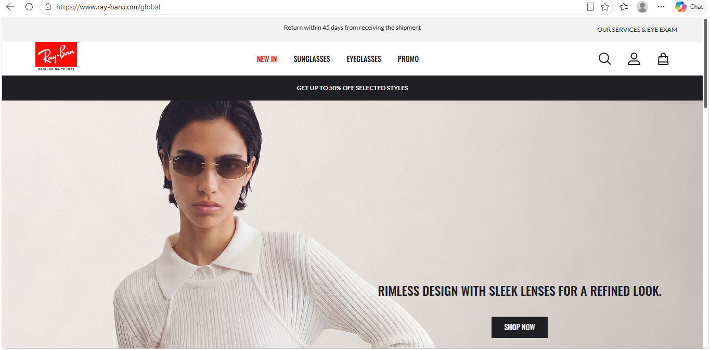

# Assignment 2 - Ray-Ban clone

Reference site: Ray-Ban Global
URL: https://www.ray-ban.com/global
Screenshot: 

Pages

- index.html - landing page (hero, women/men/kids, sliding new arrivals row, footer)
- sunglasses.html - all sunglasses page (filter bar + big product boxes)
- product.html - product page for RB2236

Notes

- Bootstrap 5 (CDN) is used for the navbar (navbar, collapse) and the two columns on the product page (row, col-md-6)
- Everything else is my own flexbox and media queries in styles.css
- The new arrivals row slides with the arrow button (pure CSS, no JavaScript)
- Hover over a menu tab to see the dropdown (desktop only)
- Hover over RB2236 and CATS 5000 CLASSIC to see the second picture
- Add to Cart buttons do not work yet
